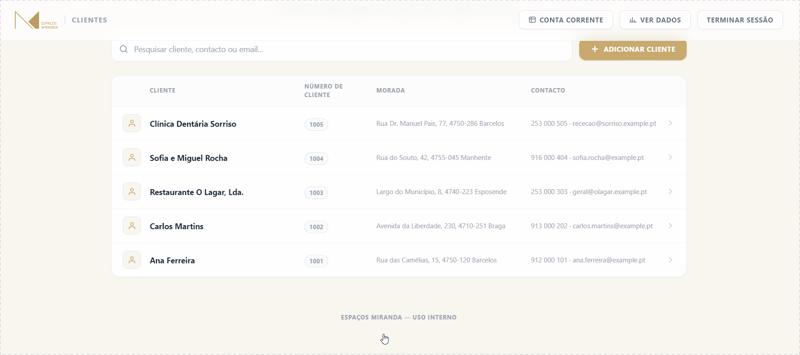
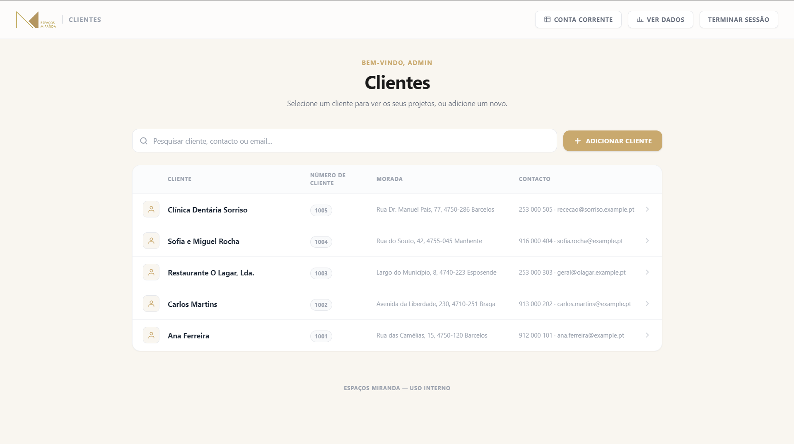
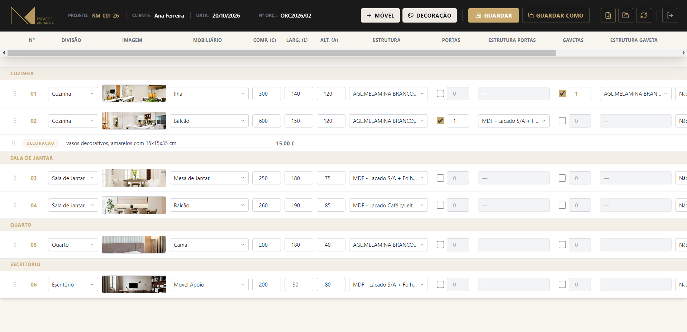
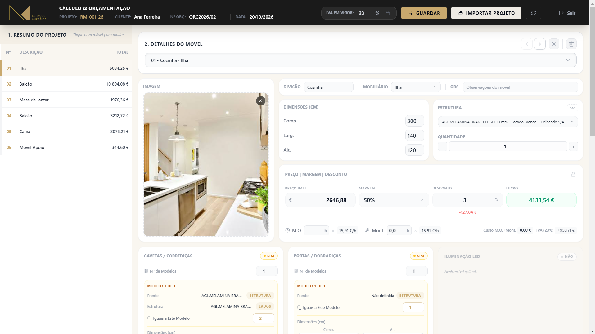
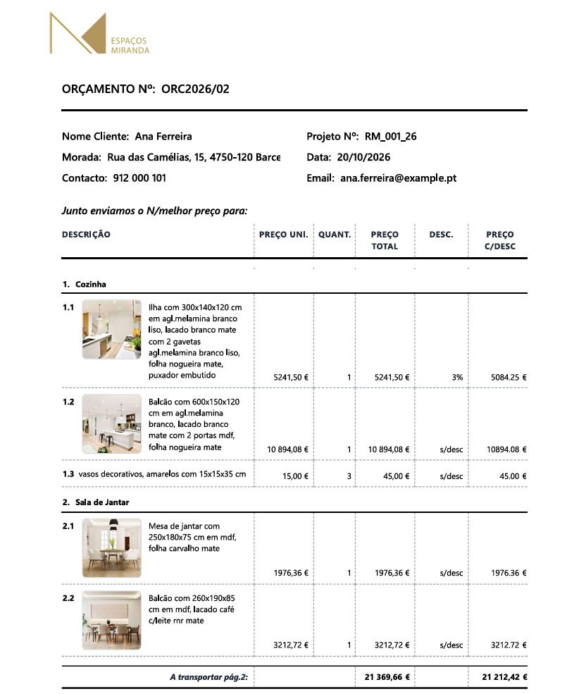
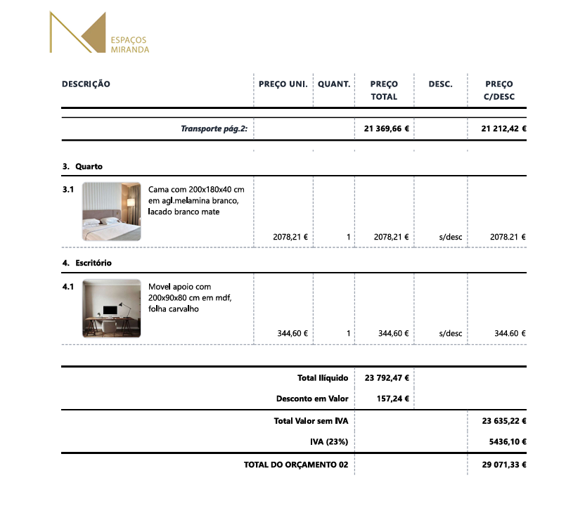
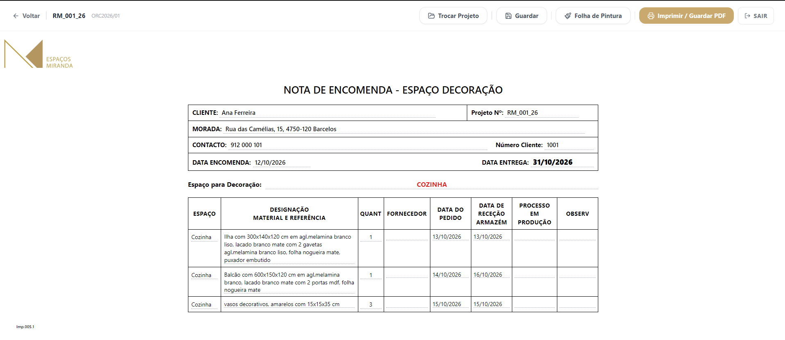

# Gestor Orçamentos Espaços Miranda

Aplicação desktop para criação e gestão de orçamentos de mobiliário à medida, desenvolvida de raiz para uso interno da empresa **Espaços Miranda**.

> **Nota:** este repositório serve apenas para distribuir os instaladores e as atualizações automáticas da aplicação. O código-fonte é privado, por incluir regras de negócio e configurações internas da empresa. Todas as imagens abaixo usam dados fictícios.

  

## O que a aplicação faz

- Criação de orçamentos de mobiliário com cálculo automático de preços (estruturas, portas, gavetas, ferragens, acabamentos e iluminação)
- Apresentação do orçamento ao cliente, com paginação automática, pronta a imprimir ou exportar em PDF
- Nota de encomenda e folha de pintura para a produção, geradas automaticamente a partir do orçamento
- Conta corrente por cliente, com o valor pago e o que falta pagar em cada projeto
- Gestão de clientes e projetos, partilhados entre vários postos de trabalho em rede local
- Perfis de administrador e de utilizador: custos e margens visíveis apenas para o administrador
- Painel de administração para configuração de margens, mão de obra e dados de base
- Backups automáticos da base de dados
- Atualizações automáticas: cada posto deteta e instala novas versões sozinho

## Capturas de ecrã

### Clientes

### Configuração dos móveis

### Cálculo e orçamentação (administrador)

### Orçamento para o cliente

  
  

### Nota de encomenda para a produção

## Tecnologias

| Camada | Tecnologia |
|---|---|
| Interface | React + Tailwind CSS |
| Aplicação desktop | Electron (`electron-builder`, `electron-updater`) |
| Servidor | Node.js + Express |
| Base de dados | SQLite |
| Dados de preços | Integração com ficheiros Excel |
| Distribuição | GitHub Releases + atualização automática |

## Arquitetura

- **Servidor central** na rede da empresa, que guarda a base de dados e corre como serviço do Windows, com arranque automático.
- **Aplicação cliente** instalada em cada posto de trabalho, que comunica com o servidor pela rede local.
- **Atualizações** publicadas aqui como releases; os postos descarregam-nas e aplicam-nas automaticamente.

## Instalação

A aplicação destina-se a uso interno. Para funcionar, precisa de acesso à rede da empresa e de credenciais válidas, por isso instalá-la fora desse contexto não dá acesso a nada.

O instalador mais recente está na secção [Releases](https://github.com/R0DRAPT/gestor-orcamentos-releases/releases).

## Sobre o projeto

Projeto desenvolvido e mantido de ponta a ponta por [Rodrigo Miranda](https://github.com/R0DRAPT): interface, servidor, base de dados, integração com Excel, empacotamento e sistema de atualizações automáticas.
